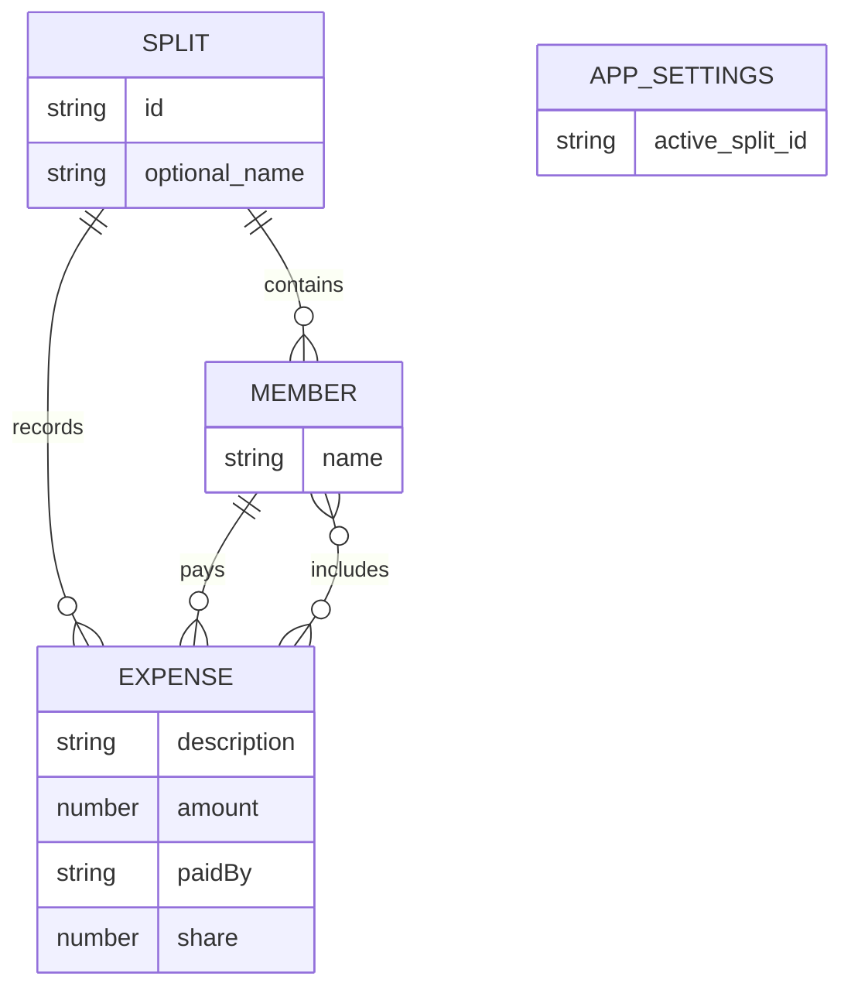

# Expense Group Wallet ER Diagram

## Relationship Notes

- Each saved `SPLIT` can have an optional name, members, and expenses.
- The application setting stores which split is currently active.
- A `SPLIT` contains multiple `MEMBER` records.
- A `SPLIT` records multiple `EXPENSE` records.
- Each `EXPENSE` has one payer from the group's members.
- Each `EXPENSE` can include multiple members who split the cost.
- `share` is calculated as `amount / number of participants`.

The local JSON store keeps a list of splits and an active split ID. The PostgreSQL store uses groups as splits and records the active split ID in `app_settings`.
